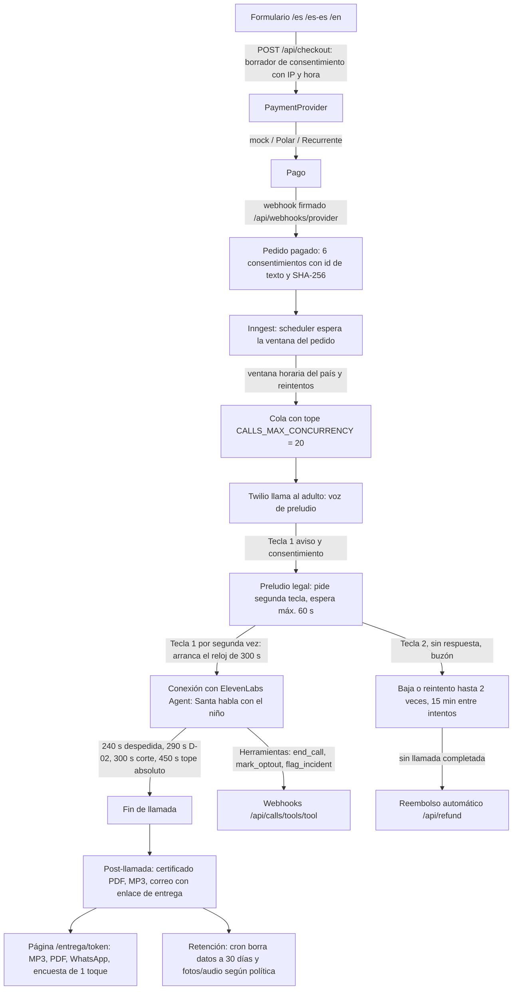

# Motor de llamadas (`engines/calls`)

Versión alineada con `legal-v1.1`. Aplica a Santa y Reyes Magos. Código en `engines/calls/src`; la web (`apps/web`) solo expone rutas y páginas.

## Flujo

Eventos de PostHog (`analytics/events.ts`): `landing_view`, `form_started`, `consent_given`, `checkout_started`, `paid`, `call_scheduled`, `call_started`, `call_attempt_ended`, `call_completed`, `delivered`, `survey_answered`, reembolso y baja.

## Qué llave conecta qué

| Variable | Conecta | Sin ella |
|---|---|---|
| `PAYMENT_PROVIDER` + `POLAR_*` | Checkout, webhook y reembolso en Polar (principal) | Mock con aviso; en producción falla |
| `RECURRENTE_*` | Plan B de cobro (Svix, secreto en base64) | Mock |
| `VOICE_PROVIDER=elevenlabs` + `ELEVENLABS_API_KEY`, `ELEVENLABS_VOICE_ID_*`, `ELEVENLABS_LLM`, `ELEVENLABS_AGENT_ID_*` | Crea o sincroniza un agente por idioma y lo conecta al número | Voz mock |
| `AGENT_TOOL_SECRET` | Cabecera `x-agent-secret` de las herramientas del agente hacia `/api/calls/tools/*` | Herramientas rechazadas |
| `TELEPHONY_PROVIDER=twilio` + `TWILIO_ACCOUNT_SID`, `TWILIO_AUTH_TOKEN`, `TWILIO_FROM_NUMBER` o `TWILIO_FROM_<CC>` | Llamadas salientes, TwiML, firma de webhooks `/api/calls/twilio/voice` y `/status` | Telefonía mock |
| `PUBLIC_BASE_URL` | URLs públicas que Twilio y los correos necesitan | localhost |
| `EMAIL_PROVIDER` + `RESEND_API_KEY`, `RESEND_FROM` | Correos de confirmación, entrega, reembolso | Correo mock (archivo) |
| `DB_PROVIDER` + `SUPABASE_URL`, `SUPABASE_SERVICE_ROLE_KEY` | Pedidos, consentimientos, incidentes, eventos | JSON en `apps/web/.data` |
| `STORAGE_PROVIDER` + `SUPABASE_BUCKET` | MP3 y PDF | Disco local |
| `PDF_RENDER_URL`, `PDF_RENDER_TOKEN` | Render del certificado | PDF interno simple |
| `INNGEST_EVENT_KEY`, `INNGEST_SIGNING_KEY` (`INNGEST_DEV=1` en local) | Scheduler y crons en `/api/inngest` | Despachador en memoria |
| `POSTHOG_KEY`, `POSTHOG_HOST` | Eventos del embudo | Eventos a la base mock |
| `CALLS_MAX_CONCURRENCY` | Tope de concurrencia (plan ElevenLabs Pro: 20) | 20 |
| `LEGAL_HOLDER`, `LEGAL_ADDRESS`, `LEGAL_EFFECTIVE_DATE` | Páginas legales y textos de consentimiento | Producción bloqueada |
| `PHONE_HASH_SALT` | Hash de teléfonos para lista de bajas | Valor de desarrollo |

## Reglas de duración (legal-v1.1)

Reloj de conversación 300 s desde la segunda tecla 1; despedida a 240 s; D-02 a 290 s; corte duro 300 s; tope absoluto de la llamada completa 450 s (límite de Twilio `TimeLimit`); espera de la segunda tecla 60 s (aviso a 30 s); silencio 8 / 16 / 36 s.

## Cierres forzados (17 reglas en `guardrails/config.ts`)

F-01 baja, F-02 adulto pide colgar, F-03 emergencia, F-03b sin cierre ("se cayó", D-07), F-04 maltrato, F-05 autolesión, F-06 dato concreto por segunda vez, F-07 contenido, F-08 abuso, F-09 silencio, F-10 adulto confundido, F-11 tiempo, F-12 latencia, F-13 idioma, F-14 adulto pide contacto, F-14b niño sin cierre (D-08), F-15 despedida abreviada. El prompt las repite; el código las impone.

## Respaldo y tests

- Cambio de proveedor por variable de entorno (`*_PROVIDER`). Respaldo de voz, LLM e imagen: pendiente de probar con cuentas (ver `pendientes-cuentas.md`).
- Tests: `npm test` (motor completo con mocks, webhooks firmados, scheduler, guardrails, web e2e).
- Prueba de carga antes de Nochebuena (200 llamadas/hora): pendiente.
